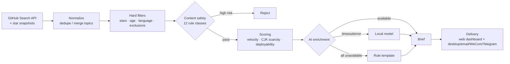

# Intel Radar

[](https://github.com/cyn-nya/intel-radar/actions/workflows/ci.yml)
[](LICENSE)
[](https://www.python.org/)


[中文](README.md) | **English**

> A local-first open-source intelligence pipeline built for an unreliable environment. API quotas get exhausted, upstream domains become unreachable, laptops get unplugged, and models time out and hallucinate. Every stage defines a degradation path, and each of those paths originates from a failure observed in production rather than from design speculation.

---

## Scope

Monitors GitHub repositories that are gaining traction rapidly while having little to no Chinese-language coverage, and produces a structured brief for each candidate: purpose, target audience, deployment path, monetization angle, and risk notes.

The pipeline skeleton is decoupled from its data source, so additional signal sources can be attached:

```
collect → normalize → filter → score → enrich → deliver → notify
```


---

## Design Decisions

"GitHub trending monitoring" is a crowded and largely homogeneous space. Existing projects generally stop at *fetch and display*; the engineering effort here is concentrated on data-source reliability and result quality.

| Aspect | Common approach | This project |
|---|---|---|
| Data source | Scrape `github.com/trending` | GitHub Search API + self-maintained star snapshots |
| Growth rate | Use the page's "stars today" | Persist snapshots and difference over time; distinguish **measured** from **estimated** |
| Result quality | Display as-is | Content safety layer filters before scoring |
| AI unavailable | Feature fails entirely | Tiered degradation; runs with zero configuration |
| Runtime assumptions | Always-on desktop | Power-aware scheduling; skips when unplugged, catches up when plugged in |

Three decisions worth detailing:

**The data source is constrained by the network environment.** On the development machine, `github.com` proved unreachable while `api.github.com` remained available, which rules out the conventional approach of scraping the trending page. The Search API returns only current star counts and no growth rate, so the system persists timestamped snapshots and computes deltas itself.

**Growth rates require a confidence label.** Running multiple times per day yields adjacent snapshots separated by very short intervals. One case extrapolated linearly to 1691 stars/day from snapshots 9 minutes apart, on a repository with 2203 stars in total. When the snapshot span falls below `min_span_hours` (default 6 hours), extrapolation is refused: the system falls back to the lifetime average and labels the result as estimated.

**Rapid growth does not imply suitability as content.** The top of the ranking was at one point dominated by DRM circumvention tools, CVE exploits, and jailbreak utilities, all of which satisfy both "growing fast" and "scarce Chinese coverage". The safety layer therefore intervenes before scoring rather than filtering at display time.

---

## Architecture



Roughly 3,900 lines of Python and 1,000 lines of frontend code. The frontend is plain HTML/JS/CSS with no build step and no npm dependency.

---

## Degradation Strategy

The governing principle: failure in any single stage must not halt the pipeline.

| Stage | Normal path | Degraded path | Trigger |
|---|---|---|---|
| Data source | Authenticated, 5000 core requests/hour | Unauthenticated, 60/hour; README fetching skipped | `GITHUB_TOKEN` not configured |
| Velocity | Snapshot differencing, labelled measured | Lifetime average (stars ÷ repo age × 0.6), labelled estimated | Snapshot span under 6 hours |
| AI enrichment | Cloud API | Local model, then rule template | API timeout / 429 / connection reset |
| Scheduling | Task fires on schedule | Skipped when unplugged; runs on power restore | Power state check |

**It runs without configuration.** With no credentials supplied, briefs are generated from rule templates. Expressiveness and ranking precision degrade, but the pipeline completes.

---

## Getting Started

```bash
git clone https://github.com/cyn-nya/intel-radar.git
cd intel-radar

python -m venv .venv
.venv/Scripts/activate          # Windows
# source .venv/bin/activate     # macOS / Linux
pip install -r requirements.txt

python run.py serve             # dashboard at http://127.0.0.1:8787
```

Windows wrappers are provided:

| Purpose | Script |
|---|---|
| Open the dashboard | `启动看板.bat` |
| Run collection once | `跑一次采集.bat` |
| Check configuration | `体检.bat` |
| Register daily tasks | `安装定时任务.bat` |
| Remove daily tasks | `卸载定时任务.bat` |

CLI entry points:

```bash
python run.py serve       # start the dashboard
python run.py once        # one collection pass, ignoring the power guard
python run.py auto        # one pass, skipped when unplugged (used by scheduled tasks)
python run.py diagnose    # environment check
python run.py status      # current status
```

### Tests

```bash
pip install -r requirements-dev.txt
pytest tests/ -v
```

93 tests, all offline. No network access; `power_state` is stubbed via fixture and does not require real battery hardware.

---

## Configuration

Copy `.env.example` to `.env` and fill in what you need. Leaving everything blank still runs; output quality is reduced.

| Variable | Effect | Consequence if unset |
|---|---|---|
| `GITHUB_TOKEN` | Raises the core quota from 60/hour to 5000/hour | README coverage is limited; "CJK scarcity" and "deployability" become largely inert |
| `LLM_API_KEY` | Cloud model for brief generation | Falls back to local model or rule templates |
| `WECOM_WEBHOOK` | WeCom group bot notifications | One fewer notification channel |
| `TELEGRAM_BOT_TOKEN` | Telegram notifications | One fewer notification channel |

Remaining settings live in `config.yaml` (commented line by line) or can be changed from the dashboard settings page, which writes to `data/overrides.yaml` rather than mutating the primary config.

The AI layer works with any OpenAI-compatible provider; switching requires changing two lines:

```yaml
llm:
  mode: hybrid          # try each in order, degrade on failure
  prefer: api           # api first (fast); set to local for cost over latency
  api:
    base_url: https://llmapi.paratera.com
    model: DeepSeek-V4.1-Flash
    key_env: ""         # when empty, LLM_API_KEY then DEEPSEEK_API_KEY
```

Credentials are read from environment variables only, never from configuration files, since configuration files are committed. The `secret-scan` job in CI enforces this (`.github/workflows/ci.yml`).

---

## Postmortems

Every item below comes from an actual run. Most were not reproducible in unit tests and were only diagnosable from production logs.

| Symptom | Root cause | Resolution |
|---|---|---|
| Quota raised to 5000, yet only 10 READMEs fetched and 0 revalidations | `_request` read `x-ratelimit-remaining` from any response unconditionally; the search endpoint returns the *search* quota (30/min), overwriting the core quota with 29 | Bucket quotas by `x-ratelimit-resource` so they no longer contaminate each other |
| Velocity reported as 1691 stars/day on a repository with 2203 stars total | Multiple runs per day produced snapshots 9 minutes apart, which were extrapolated linearly | Refuse extrapolation below `min_span_hours`; relabel as estimated |
| All scores saturated at 0.750 with no discrimination | Velocity threshold capped too low; deployability scored 0 when README fetch failed | Missing sub-scores are excluded from weighting (`None`, not 0), ceding weight to other signals |
| Top ten consisted of DRM circumvention, CVE exploits, and jailbreak tools | These satisfy both "fast growth" and "scarce Chinese coverage" | `safety.py` intercepts before scoring, across 12 rule classes |
| AI enrichment failed silently, producing empty bodies | Thinking models such as qwen3 consume the entire token budget during reasoning (measured: all 120 tokens) | Append `think: false` automatically, and recover from the `thinking` field as a fallback |
| 2 of 3 AI cards failed at 86 seconds each | Prompts imposed no length limit; the model wrote ~400 characters per field across 5 fields and hit `max_tokens`, truncating the JSON | Per-field character caps (≤400 total) and `max_tokens` raised to 2200 as a safety margin. Result: 4/4 success, 30 seconds average |
| Small model emitted repeated text until truncation | 0.6B-class models fall into repetition loops | `_dedupe_repeats()` strips consecutive duplicates; JSON parse failures retry at lower temperature |
| Every local model call timed out | 180-second timeout against a 6000-character README, while CPU-only inference runs at roughly 1.3 tokens/second | Timeout raised to 420 seconds; README length is now per-engine (2500 local / 6000 API) |
| Batch enrichment always ran locally first, turning a 3-minute pass into 20 minutes | `_chain()` hardcoded "local first for batch", an assumption from when local was free and API was metered | Replaced with configurable `llm.prefer`, defaulting to api |
| Configured `qwen3:8b` but only `qwen3:4b` was pulled; calls returned 404 | Availability probing matched on model family name and produced false positives | Fall back to the largest available model in the same family, and annotate the substitution in the settings page |
| Rule-based cards generated before AI was configured never upgraded afterwards | Refresh logic only checked `ai_at`, so rule cards were skipped as "generated today" | Rule cards are treated as upgrade candidates, prioritized after cardless repos and before expiry-driven refreshes |
| `/api/status` took 15 seconds to respond | Every poll probed Ollama with a 5-second timeout ceiling | 60-second TTL cache on probe results; measured down to 0.07 seconds |
| Interrupted runs remained "in progress" indefinitely | A killed process had no opportunity to finalize state | `close_stale_runs()` on startup and before each collection |
| Every page load produced an ASGI error | `/favicon.ico` returned a 2-byte body via `JSONResponse({}, 204)`, violating the 204 specification | Switched to `Response(204)` with no body |
| Launching twice raised `[Errno 10048] port already in use` | No port occupancy check | Probe `/api/health` first; if it is our own instance, open the existing dashboard |
| Batch scripts produced a wall of `is not recognized` errors | `cmd.exe` parses batch files using the system ANSI codepage (cp950 on Traditional Chinese systems), so UTF-8 Chinese bytes desynchronized | Batch files reduced to pure ASCII; all Chinese output delegated to `run.py` |
| `.ps1` reported syntax errors pointing at incorrect line numbers | Windows PowerShell decodes BOM-less scripts as ANSI, desynchronizing on Chinese comments | `tools/*.ps1` saved as UTF-8 with BOM |
| Embedding `python -c "..."` inside PowerShell raised `Missing expression after ','` | Quote nesting across two languages; PowerShell parsed the Python code as an expression | Extracted to a standalone `tools/print_times.py` |
| Headless runs (`pythonw`) failed with no diagnosable trace | `pythonw.exe` has no stdout, and the project had no file logging | `run.py` logs uniformly to `data/radar.log` with 4×2MB rotation |
| Logs flooded by HTTP client output | httpx logs every request at INFO | `httpx` and `httpcore` lowered to WARNING |
| Prompt instructions appeared in AI output | The JSON skeleton in the prompt used full sentences as example values, which small models copied verbatim | Skeleton changed to `<placeholder>` form, plus `_clean()` to strip echoed instructions |
| Fields occasionally disappeared entirely, breaking card rendering | Small models sometimes returned fields as nested objects or arrays | `_clean()` flattens dicts and lists to strings |

---

## Related Work

A survey was conducted via the GitHub Search API across several keyword combinations (star counts as of 2026-10-27):

| Project | Stars | Focus | Overlap |
|---|---|---|---|
| [vitalets/github-trending-repos](https://github.com/vitalets/github-trending-repos) | 3031 | Trending results as GitHub notifications | Low |
| [bonfy/github-trending](https://github.com/bonfy/github-trending) | 1240 | Daily trending list | Low |
| [huchenme/github-trending-api](https://github.com/huchenme/github-trending-api) | 836 | API wrapper over trending data | Low |
| [emanuelef/daily-stars-explorer](https://github.com/emanuelef/daily-stars-explorer) | 411 | Star trend visualization | Medium |
| [LokeshNanda/oss-radar-ai](https://github.com/LokeshNanda/oss-radar-ai) | 28 | AI-driven OSS intelligence | High |

The space already has thousand-star projects, but they focus on *fetch and display*. The most-starred project with a comparable concept sits below 30 stars, which suggests the differentiation lies in engineering completeness and filtering quality rather than in the idea.

---

## Limitations

- **No measured velocity during cold start.** At least two collections spanning 6+ hours are required before the system switches from estimated to measured.
- **No concurrency.** Collection is sequential: several minutes per pass without a token, roughly 1–2 minutes with one.
- **AI output is not fact-checked.** Briefs are model-generated and may state deployment steps with unwarranted confidence. Verify manually before using them as source material.
- **One of three planned pipelines is implemented.** Tender monitoring and vertical-domain translation are not built, though the skeleton reserves extension points (`radar/sources/`).
- **Windows-first.** Scheduled tasks use Windows Task Scheduler; Linux and macOS require cron.

---

## Compliance and Scope

This tool filters and organizes publicly available information. It does not scrape GitHub web pages and does not circumvent any access control.

One point deserves emphasis: translating and redistributing another project's README is copyright infringement. The output here is a judgment about which projects merit attention, plus a direction for further work. It is not publishable content in itself.

---

## License

[MIT](LICENSE)
