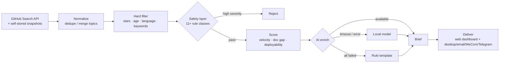

# Intel Radar

[](https://github.com/cyn-nya/intel-radar/actions/workflows/ci.yml)
[](LICENSE)
[](https://www.python.org/)

[中文](README.md) | **English**

> **A local-first intelligence pipeline that degrades gracefully in a hostile environment.**
>
> API quotas get exhausted. The obvious endpoint is unreachable. The laptop gets unplugged.
> Models time out and confidently make things up. Every layer of this system has a fallback —
> and every fallback was earned by hitting the real failure, not designed on a whiteboard.

A self-hosted service that finds fast-rising GitHub repositories with little to no Chinese
documentation, and generates an actionable brief for each one.

Generic pipeline: `collect → normalize → filter → score → AI enrich → deliver → notify`.


---

## Why this is not "yet another trending scraper"

"GitHub trending monitor" is a crowded space with several 1k+ star projects. But they all
stop at *fetch and display*.

| | Typical approach | This project |
|---|---|---|
| Data source | Scrape `github.com/trending` | GitHub Search API + **own star snapshots** |
| "Velocity" | Read "stars today" off the page | Store snapshots, diff over time windows, distinguish **measured** from **estimated** |
| Result quality | Show as-is | 11+ safety rules reject junk *before* ranking |
| AI failure | Feature breaks | Four-level fallback; **runs with zero configuration** |
| Runtime assumptions | Desktop, always on | Power-aware: skips on battery, catches up when plugged in |

Three concrete differences:

- **Scraping wasn't an option, so the harder path was taken.** `github.com` is unreachable from
  the machine this was built on; only `api.github.com` works. The Search API returns a *current*
  star count and no velocity at all — so the system stores its own snapshots and diffs them.
- **Velocity lies, so there is a gate.** Running several times a day means two snapshots can be
  9 minutes apart. Linear extrapolation produced **1691 stars/day** for a repository that had
  2203 stars total. When the span is below `min_span_hours` (default 6h), the system **refuses to
  extrapolate**, falls back to a lifetime average, and labels it as an estimate.
- **Fast-rising ≠ publishable.** The top of the ranking was once entirely DRM cracks, CVE
  exploits, and jailbreak tools — they satisfy "rising fast + little Chinese coverage" perfectly.
  A safety layer now hard-rejects them *before* scoring.

---

## Architecture



~3,900 lines of Python and ~1,000 lines of frontend. The frontend is dependency-free
vanilla HTML/JS/CSS — no bundler, no `npm install`.

---

## Graceful degradation

The central design stance: **no single failed layer should stop the pipeline.**

| Layer | Normal | Degraded | Trigger |
|---|---|---|---|
| Data source | Token, 5,000 core req/hr | No token, 60/hr, README fetch skipped | `GITHUB_TOKEN` unset |
| Velocity | Snapshot diff, labelled *measured* | Lifetime average, labelled *estimated* | Snapshot span < 6h |
| AI | Cloud API (fast, good) | Local model → rule template | Timeout / 429 / connection reset |
| Scheduling | Scheduled task fires | Skips on battery, catches up when plugged in | Power guard verdict |

**It runs with zero configuration.** With no keys at all, briefs come from a rule-based
template — plainer output and coarser ranking, but nothing crashes.

---

## Quick start

```bash
git clone https://github.com/cyn-nya/intel-radar.git
cd intel-radar

python -m venv .venv
source .venv/bin/activate        # macOS / Linux
# .venv/Scripts/activate         # Windows
pip install -r requirements.txt

python run.py serve              # dashboard at http://127.0.0.1:8787
```

```bash
python run.py once        # collect once, ignoring the power guard
python run.py auto        # collect once, skip if on battery (used by the scheduler)
python run.py diagnose    # environment self-check
python run.py status      # current state
```

### Tests

```bash
pip install -r requirements-dev.txt
pytest tests/ -v
```

93 tests, **fully offline** — no network, and no dependency on a real battery
(`power_state` is stubbed by a fixture).

---

## Configuration

Copy `.env.example` to `.env`. Everything is optional.

| Variable | Effect | Cost of omitting |
|---|---|---|
| `GITHUB_TOKEN` | Core quota 60/hr → **5,000/hr** | Few READMEs fetched; two scoring signals degrade |
| `LLM_API_KEY` | Cloud model for brief generation | Falls back to local model or rule template |
| `WECOM_WEBHOOK` | WeCom (WeChat Work) bot push | One fewer channel |
| `TELEGRAM_BOT_TOKEN` | Telegram push | One fewer channel |

The AI layer works with **any OpenAI-compatible provider** — switching providers means editing
two lines:

```yaml
llm:
  mode: hybrid          # try the chain in order, degrade on failure
  prefer: api           # api-first (fast); local means local-first (cheap but slow)
  api:
    base_url: https://llmapi.paratera.com
    model: DeepSeek-V4.1-Flash
    key_env: ""         # empty = try LLM_API_KEY, then DEEPSEEK_API_KEY
```

> **Secrets are read from environment variables only, never from config files** — config files
> are meant to be committed. CI enforces this with a dedicated `secret-scan` job.

---

## Bugs worth reading about

The most interesting part of this project. Every row was a real failure, not a hypothetical.

| Symptom | Actual root cause | Fix |
|---|---|---|
| 5,000-request quota, yet only 10 READMEs fetched and 0 refreshes | `_request` read `x-ratelimit-remaining` from **any** response; the search endpoint returns the *search* quota (30/min), clobbering the core budget to 29 | Route by `x-ratelimit-resource` so quota buckets stay separate |
| Velocity showed "1691 stars/day" for a 2203-star repo | Multiple runs per day meant snapshots 9 minutes apart, linearly extrapolated | Refuse to extrapolate below `min_span_hours`; label as estimate |
| Every score pinned at exactly 0.750 | Velocity ceiling too low; deployability coerced to 0 when README was missing | Missing signals get weight 0 (`None`, not `0`) instead of dragging scores down |
| Top 10 were DRM cracks, CVE exploits, jailbreak tools | They satisfy "rising fast + little Chinese coverage" | `safety.py` hard-rejects *before* scoring, 11+ rule classes |
| AI enrichment silently produced empty bodies | Thinking models (qwen3) burn the entire token budget on reasoning (120/120 tokens observed) | Auto-inject `think: false`; recover from the `thinking` field as fallback |
| 2 of 3 AI briefs failed, at 86s each | Prompt had **no length constraint**; the model wrote 400 words per field and hit `max_tokens` mid-JSON | Per-field character caps (≤400 total), `max_tokens` raised to 2200 as a safety net. **Result: 4/4 success, 30s average** |
| Small model emitted "developer, developer, developer…" until truncation | 0.6B-class models fall into repetition loops | `_dedupe_repeats()` collapses consecutive duplicates; failed JSON parsing retries at lower temperature |
| Local model timed out on every call | 180s timeout with a 6,000-char README, on CPU inference running ~**1.3 tokens/sec** | Timeout raised to 420s; README cap varies by engine (2,500 local / 6,000 API) |
| Batch enrichment always ran locally first, turning 3 minutes into 20 | `_chain()` hardcoded "local-first for bulk" — an assumption from when local was free and API cost money | Made configurable via `llm.prefer`, defaulting to api-first |
| `/api/status` took 15 seconds to respond | Every poll probed Ollama with a 5s timeout | 60s TTL cache on probes — **measured drop to 0.07s** |
| Interrupted runs stayed "in progress" forever | Killed processes never got to clean up | `close_stale_runs()` on startup and before each collection |
| An ASGI error on every page load | `/favicon.ico` returned a 2-byte body via `JSONResponse({}, 204)`, violating the 204 spec | Bodyless `Response(204)` |
| Double-clicking the launcher → `[Errno 10048] port in use` | No port-occupancy check | Probe `/api/health`; if it's ours, just open the existing instance |
| `.bat` files printed `is not recognized` on every line | `cmd.exe` parses batch files with the system ANSI codepage (cp950 on this machine); UTF-8 Chinese corrupted the byte stream | Batch files are **pure ASCII**; all Chinese output delegated to `run.py` |
| `.ps1` reported syntax errors **on the wrong line numbers** | Windows PowerShell decodes a BOM-less `.ps1` as ANSI; Chinese comments corrupted the stream | All `tools/*.ps1` saved as **UTF-8 with BOM** |
| Embedding `python -c "..."` inside PowerShell failed with `Missing expression after ','` | Nested quoting across two languages — PowerShell parsed the Python as an expression | Extracted to a standalone `tools/print_times.py` |
| Nothing was logged when running windowless (`pythonw`) | `pythonw.exe` has no stdout at all, and the project had no file logging | `run.py` writes `data/radar.log` (4×2MB rotation) |
| Logs drowned in httpx noise | httpx logs **every** HTTP request at INFO | Silenced `httpx`/`httpcore` to WARNING |
| AI output ended with "if the project has no monetization value, say so" | The JSON skeleton in the prompt used full sentences as example values, and the small model copied them | Skeleton uses `<placeholder>` form, plus a `_clean()` pass to strip echoes |
| Fields occasionally vanished, breaking the whole card | The model sometimes returned a field as a nested object or array | `_clean()` flattens dict/list into a string |

---

## Related projects

A survey via the GitHub Search API across several keyword sets:

| Project | Stars | What it does | Overlap |
|---|---|---|---|
| [vitalets/github-trending-repos](https://github.com/vitalets/github-trending-repos) | 3028 | Pushes trending into GitHub notifications | Low |
| [bonfy/github-trending](https://github.com/bonfy/github-trending) | 1237 | Daily trending list | Low |
| [huchenme/github-trending-api](https://github.com/huchenme/github-trending-api) | 836 | API wrapper for trending | Low |
| [emanuelef/daily-stars-explorer](https://github.com/emanuelef/daily-stars-explorer) | 411 | Star trend visualization | Medium |
| [LokeshNanda/oss-radar-ai](https://github.com/LokeshNanda/oss-radar-ai) | 28 | AI-driven OSS intelligence | **High** |

Takeaway: the category is well known, but every 1k+ star project stops at *fetch and display*.
Projects sharing this concept top out at 28 stars — the difficulty is engineering completeness
and output quality, not the idea.

---

## Known limitations

Listed honestly, because that is more useful than hiding them:

- **No real velocity on cold start.** Requires two collections at least 6 hours apart before
  switching from *estimated* to *measured*.
- **No real concurrency.** Collection is sequential; a full run takes 1–2 minutes with a token,
  several minutes without.
- **AI briefs are not fact-checked.** The model can state deployment steps confidently and be
  wrong. Verify before using a brief as source material.
- **Only one of three planned pipelines exists.** Tender monitoring and vertical translation are
  not built; the extension point is `radar/sources/`.
- **Windows-first.** Scheduling uses Windows Task Scheduler; Linux/macOS needs cron instead.

---

## License

[MIT](LICENSE)
