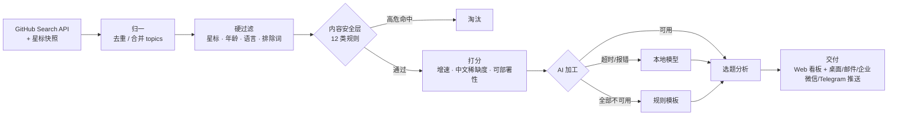

# Intel Radar

[](https://github.com/cyn-nya/intel-radar/actions/workflows/ci.yml)
[](LICENSE)
[](https://www.python.org/)


**中文** | [English](README.en.md)

> 本地优先的开源情报流水线。运行环境假定为不可靠：API 配额会耗尽、上游域名会不可达、笔记本会拔掉电源、模型会超时并产生幻觉。系统在每一层都定义了降级路径，且这些路径来自实际运行中暴露的故障，而非设计阶段的推演。

---

## 功能范围

监测 GitHub 上近期增长显著、而中文资料近乎空白的开源项目，为每个候选生成结构化的选题分析：用途、目标受众、部署路径、变现方式与风险提示。

流水线骨架与数据源解耦，便于接入其它信号源：

```
采集 → 归一 → 过滤 → 打分 → AI 加工 → 交付 → 推送
```


---

## 设计取舍

「GitHub trending 监测」是一个实现众多、同质化严重的赛道。现有方案普遍止步于「抓取并展示」，而本项目的实现重心在数据来源的可靠性与结果的筛选质量上。

| 维度 | 常见实现 | 本项目 |
|---|---|---|
| 数据来源 | 抓取 `github.com/trending` 页面 | GitHub Search API + 自维护星标快照 |
| 增长速度 | 直接采用页面给出的 "stars today" | 自存快照并按时间窗口差分，区分**实测**与**估算** |
| 结果质量 | 原样展示 | 内容安全层前置拦截，再进入打分排序 |
| AI 不可用 | 功能整体失效 | 分级降级，无任何配置亦可运行 |
| 运行环境 | 假定常开主机 | 电源感知调度，未通电跳过、通电补跑 |

三处关键决策：

**数据来源受限于网络环境。** 实测本机 `github.com` 不可达，仅有 `api.github.com` 可用，因此无法采用抓取页面的常规做法。Search API 只返回当前星数、不提供增长速率，系统改为按时间留存快照并自行差分。

**增长速率需要可信度标注。** 单日多次运行会产生间隔极短的相邻快照。曾出现两次快照相隔 9 分钟、被线性外推为 1691 星/天的情况，而该仓库总量仅 2203 星。因此当快照跨度低于 `min_span_hours`（默认 6 小时）时拒绝外推，退回长期均速并显式标注为估算值。

**增长快不等于适合作为内容素材。** 榜单头部一度集中出现 DRM 破解、CVE 利用与越狱工具，这些项目同时满足「增长快」与「中文资料稀缺」两个条件。安全层因此在打分之前介入，而非在展示阶段过滤。

---

## 架构



约 3900 行 Python 与 1000 行前端代码。前端为原生 HTML/JS/CSS，无构建步骤，不依赖 npm。

---

## 降级策略

核心设计原则：任一环节失效都不应导致流水线整体停摆。

| 环节 | 正常路径 | 降级路径 | 触发条件 |
|---|---|---|---|
| 数据源 | 携带 Token，核心配额 5000/小时 | 无 Token，60/小时，并跳过 README 抓取 | 未配置 `GITHUB_TOKEN` |
| 增速计算 | 快照差分，标注为实测 | 长期均速（星数 ÷ 仓库年龄 × 0.6），标注为估算 | 快照跨度不足 6 小时 |
| AI 加工 | 云端 API | 本地模型，其次规则模板 | API 超时 / 429 / 连接重置 |
| 调度 | 计划任务按时触发 | 未通电时跳过，恢复供电后补跑 | 电源状态判定 |

**无配置亦可运行。** 未提供任何密钥时，系统以规则模板生成选题分析。内容表达力与排序精度下降，但流程不中断。

---

## 快速开始

```bash
git clone https://github.com/cyn-nya/intel-radar.git
cd intel-radar

python -m venv .venv
.venv/Scripts/activate          # Windows
# source .venv/bin/activate     # macOS / Linux
pip install -r requirements.txt

python run.py serve             # 启动看板，默认 http://127.0.0.1:8787
```

Windows 环境提供了封装脚本：

| 用途 | 脚本 |
|---|---|
| 打开看板 | `启动看板.bat` |
| 立即采集一次 | `跑一次采集.bat` |
| 检查配置完整性 | `体检.bat` |
| 注册每日定时任务 | `安装定时任务.bat` |
| 移除定时任务 | `卸载定时任务.bat` |

命令行入口：

```bash
python run.py serve       # 启动看板
python run.py once        # 执行一次采集，忽略电源守卫
python run.py auto        # 执行一次采集，未通电则跳过（计划任务使用）
python run.py diagnose    # 环境体检
python run.py status      # 查看运行状态
```

### 测试

```bash
pip install -r requirements-dev.txt
pytest tests/ -v
```

共 93 个测试，全部离线执行，不访问网络；`power_state` 通过 fixture 打桩，不依赖真实电池。

---

## 配置

将 `.env.example` 复制为 `.env` 后按需填写。留空不影响运行，仅降低输出质量。

| 变量 | 作用 | 留空的后果 |
|---|---|---|
| `GITHUB_TOKEN` | 核心配额由 60/小时 提升至 5000/小时 | README 抓取量受限，「中文稀缺度」与「可部署性」两项指标基本失效 |
| `LLM_API_KEY` | 调用云端模型生成选题分析 | 降级至本地模型或规则模板 |
| `WECOM_WEBHOOK` | 企业微信群机器人推送 | 减少一个推送渠道 |
| `TELEGRAM_BOT_TOKEN` | Telegram 推送 | 减少一个推送渠道 |

其余设置位于 `config.yaml`（含逐行注释），也可在看板设置页修改，写入 `data/overrides.yaml`，不污染主配置。

AI 引擎兼容任意 OpenAI 协议服务商，切换仅需修改两行：

```yaml
llm:
  mode: hybrid          # 按链路依次尝试，前序失败自动降级
  prefer: api           # api 优先（响应快）；改为 local 则本地优先（成本低但较慢）
  api:
    base_url: https://llmapi.paratera.com
    model: DeepSeek-V4.1-Flash
    key_env: ""         # 留空时依次查找 LLM_API_KEY、DEEPSEEK_API_KEY
```

密钥仅从环境变量读取，不写入配置文件，因为配置文件需要提交至仓库。CI 中的 `secret-scan` 作业对此设有强制检查（`.github/workflows/ci.yml`）。

---

## 故障复盘

以下问题均来自实际运行记录。其中多数在单元测试中无法复现，只能通过线上日志定位。

| 现象 | 根因 | 处理 |
|---|---|---|
| 配额已提升至 5000，实际仅抓到 10 份 README，回访刷新数为 0 | `_request` 无条件从任意响应读取 `x-ratelimit-remaining`，而搜索接口返回的是搜索配额（30/分），将核心配额覆盖为 29 | 依据 `x-ratelimit-resource` 区分配额桶，避免相互污染 |
| 增速显示为 1691 星/天，而仓库总量仅 2203 星 | 单日多次运行导致相邻快照间隔仅 9 分钟，被线性外推 | 跨度低于 `min_span_hours` 时拒绝外推，改标为估算 |
| 全部分数堆积在 0.750，无区分度 | 增速阈值封顶过低；README 抓取失败时「可部署性」被计为 0 | 缺失数据的子项不参与加权（记为 `None` 而非 0），权重让渡给其它信号 |
| 榜单前十为 DRM 破解、CVE 利用与越狱工具 | 上述项目同时满足「增长快」与「中文资料稀缺」 | `safety.py` 在打分前硬拦截，覆盖 12 类规则 |
| AI 加工静默失效，正文为空 | qwen3 等思考模型将完整 token 预算消耗于思考阶段（实测 120 token 全部耗尽） | 自动附加 `think: false`，并从 `thinking` 字段兜底提取 |
| 3 张 AI 卡片中 2 张失败，单张耗时 86 秒 | 提示词未约束长度，模型为 5 个字段各输出约 400 字，触发 `max_tokens` 后 JSON 被截断 | 为每个字段设定字数上限（合计 ≤ 400 字），`max_tokens` 提升至 2200 作为安全边界。调整后 4/4 成功，平均 30 秒 |
| 小模型输出重复文本直至截断 | 0.6B 级模型易进入复读循环 | 以 `_dedupe_repeats()` 移除连续重复项；JSON 解析失败时降低温度重试 |
| 本地模型每次调用均超时 | 180 秒超时限制下仍需处理 6000 字 README，而纯 CPU 推理速率约为 1.3 token/秒 | 超时提升至 420 秒；README 长度上限按引擎区分（本地 2500 字 / API 6000 字） |
| 批量加工固定优先使用本地模型，单轮耗时由 3 分钟增至 20 分钟 | `_chain()` 硬编码「批量任务本地优先」，该假设源于本地免费、API 收费的早期判断 | 改为可配置的 `llm.prefer`，默认 api 优先 |
| 配置 `qwen3:8b` 但实际仅拉取 `qwen3:4b`，调用返回 404 | 可用性探测按模型族名匹配，产生误报 | 自动回退至同族中体积最大的可用模型，并在设置页标注替换行为 |
| 未配置 AI 时生成的规则卡片，在配置 AI 后不再更新 | 重刷逻辑仅检查 `ai_at`，规则卡因「当日已生成」被跳过 | 将规则卡视为待升级项，优先级位于无卡之后、过期重刷之前 |
| `/api/status` 响应耗时 15 秒 | 每次轮询均探测 Ollama，超时上限 5 秒 | 探测结果增加 60 秒 TTL 缓存，实测降至 0.07 秒 |
| 被中断的运行永久停留在「进行中」 | 进程被终止时没有机会执行收尾逻辑 | 启动时与每次采集前调用 `close_stale_runs()` |
| 每次打开页面产生一条 ASGI 报错 | `/favicon.ico` 使用 `JSONResponse({}, 204)` 返回了 2 字节响应体，违反 204 规范 | 改用无响应体的 `Response(204)` |
| 重复启动导致 `[Errno 10048] 端口已占用` | 未实现端口占用检测 | 先探测 `/api/health`，确认为同一实例则直接打开已有页面 |
| 批处理脚本执行后大量 `is not recognized` 报错 | `cmd.exe` 以系统 ANSI 代码页解析批处理（繁体中文环境为 cp950），UTF-8 中文导致字节错位 | 批处理文件改为纯 ASCII，中文输出交由 `run.py` 处理 |
| `.ps1` 报出指向错误行号的语法错误 | Windows PowerShell 以 ANSI 解码无 BOM 的脚本，中文注释导致字节流错位 | `tools/*.ps1` 统一保存为 UTF-8 with BOM |
| PowerShell 中内嵌 `python -c "..."` 报 `Missing expression after ','` | 两种语言的引号嵌套冲突，PowerShell 将 Python 代码解析为表达式 | 拆分为独立文件 `tools/print_times.py` |
| 无窗口模式（`pythonw`）运行异常时无任何可查痕迹 | `pythonw.exe` 不提供 stdout，且项目此前无文件日志 | `run.py` 统一写入 `data/radar.log`，采用 4×2MB 轮转 |
| 日志被 HTTP 客户端刷屏 | httpx 在 INFO 级别记录每一次请求 | 将 `httpx` / `httpcore` 日志级别压低至 WARNING |
| AI 正文末尾出现提示词中的说明性语句 | 提示词内的 JSON 骨架使用长句作为示例值，小模型直接照抄 | 骨架改为 `<占位符>` 形式，并增加 `_clean()` 清理回显 |
| 字段偶发整体丢失，导致卡片渲染失败 | 小模型有时将字段返回为嵌套对象或数组 | `_clean()` 将 dict/list 统一拍平为字符串 |

---

## 相关工作

调研基于 GitHub Search API，覆盖多个关键词组合（星标数为 2026-10-27 快照）：

| 项目 | Star | 定位 | 重叠度 |
|---|---|---|---|
| [vitalets/github-trending-repos](https://github.com/vitalets/github-trending-repos) | 3031 | 将 trending 结果转为 GitHub 通知 | 低 |
| [bonfy/github-trending](https://github.com/bonfy/github-trending) | 1240 | 每日更新 trending 列表 | 低 |
| [huchenme/github-trending-api](https://github.com/huchenme/github-trending-api) | 836 | trending 数据的 API 封装 | 低 |
| [emanuelef/daily-stars-explorer](https://github.com/emanuelef/daily-stars-explorer) | 411 | 星标趋势可视化 | 中 |
| [LokeshNanda/oss-radar-ai](https://github.com/LokeshNanda/oss-radar-ai) | 28 | AI 驱动的开源情报系统 | 高 |

该赛道已有千星级项目，但均聚焦于「获取并展示」。同类概念中星标最高的项目未超过 30，表明差异化空间在工程完整度与筛选质量，而非想法本身。

---

## 当前局限

- **冷启动阶段无实测增速。** 需至少两次间隔 6 小时以上的采集，才会由估算切换为实测。
- **未实现并发。** 目前为顺序抓取，单轮采集在无 Token 时需数分钟，有 Token 时约 1 至 2 分钟。
- **AI 输出未经事实核验。** 卡片内容由模型生成，可能在部署步骤上给出看似确定但实际有误的描述，作为素材使用前需人工验证。
- **三条流水线中仅实现一条。** 标讯监控与垂直领域翻译尚未实现，但骨架已预留扩展点（`radar/sources/`）。
- **Windows 优先。** 定时任务基于 Windows 计划任务实现，Linux/macOS 需改用 cron。

---

## 合规与边界

本项目仅筛选与整理公开信息，不抓取 GitHub 网页，不绕过任何访问控制。

需要明确的是：直接翻译并二次分发他人 README 属于侵权行为。本项目的产出是对「哪些项目值得关注」的判断与选题方向，不构成可直接发布的内容成品。

---

## License

[MIT](LICENSE)
