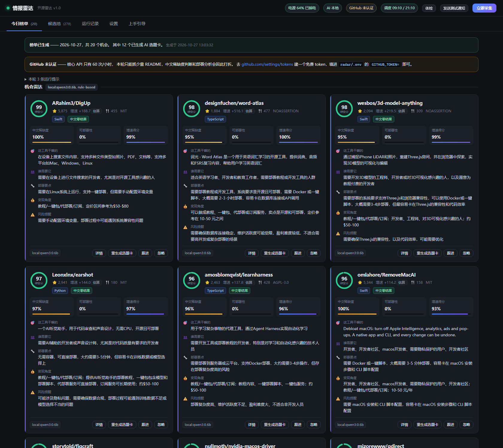
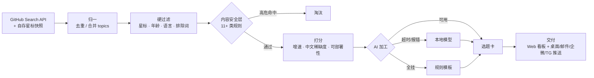

# Intel Radar · 开源情报雷达

[](https://github.com/cyn-nya/intel-radar/actions/workflows/ci.yml)
[](LICENSE)
[](https://www.python.org/)


**中文** | [English](README.en.md)

> **一个在真实恶劣环境下降级运行的本地优先情报流水线。**
>
> API 配额会被打爆、目标站点不可达、笔记本会拔电、模型会超时、AI 会一本正经地胡说 ——
> 这个系统在**每一层**都有兜底，而且每一层兜底都是实测踩出来的，不是设计文档里写的。

---

## 它做什么

监控 GitHub 上正在快速涨星、但中文资料几乎为零的开源项目，
给每个候选生成一张可以直接开工的**选题卡**（干嘛的 / 谁需要 / 怎么部署 / 怎么变现 / 有什么坑）。

骨架是通用的：`采集 → 归一 → 过滤 → 打分 → AI 加工 → 交付 → 推送`。



---

## 为什么这不是「又一个 trending 爬虫」

「GitHub trending 监控」是个被做烂的赛道，千星项目有一堆。但它们的共同点是：
**抓下来、展示出来，就结束了。**

| | 常见做法 | 本项目 |
|---|---|---|
| 数据来源 | 爬 `github.com/trending` 页面 | GitHub Search API + **自存星标快照差分** |
| 「增速」怎么算 | 用页面上的 "stars today" | 自己存快照、按时间窗口算，并区分**实测**与**估算** |
| 结果质量 | 原样展示 | 11+ 类安全规则先拦一道，再打分排序 |
| AI 挂了怎么办 | 整个功能失效 | 四级降级，**零配置也能跑** |
| 运行环境假设 | 台式机、常开 | 电源感知：没插电不跑，插上补跑 |

几个具体差异：

- **没法爬 trending，所以走了更难的路。** 实测本机 `github.com` **不可达**，只能走 `api.github.com`。
  Search API 只给「当前星数」，没有增速。于是系统自己按时间存快照，用差分算真实增速。
- **增速会骗人，所以加了闸门。** 一天跑好几次时，两次快照可能只隔 9 分钟 ——
  线性外推算出 **1691 星/天**，而那个仓库总共才 2203 星。
  所以跨度不足 `min_span_hours`（默认 6 小时）时**宁可不算**，退回长期均速并标注「估算」。
- **涨星快的东西不一定能做成内容。** 榜单前排一度全是 DRM 破解、CVE 漏洞利用、越狱工具 ——
  它们同时满足「涨星快 + 中文资料少」，打分算法会主动把它们顶上去。
  所以安全层在打分**之前**硬拦截。

---

## 架构



代码量约 **3900 行 Python + 1000 行前端**，前端是零构建的原生 HTML/JS/CSS（没有 webpack、没有 npm install）。

---

## 四级降级

这是整个项目最主要的设计取向：**任何一层挂掉都不应该让整条流水线停摆。**

| 层 | 正常情况 | 降级后 | 触发条件 |
|---|---|---|---|
| 数据源 | 带 Token，核心配额 5000/小时 | 无 Token，60/小时，自动跳过 README 抓取 | 未配置 `GITHUB_TOKEN` |
| 增速 | 快照差分，标注「实测」 | 长期均速（星数 ÷ 仓库年龄 × 0.6），标注「估算」 | 快照跨度 < 6 小时 |
| AI | 云端 API（快、质量好） | 本地模型 → 规则模板 | API 超时 / 429 / 连接重置 |
| 调度 | 计划任务到点自动跑 | 没插电跳过，插上电补跑 | 电源守卫判断 |

**零配置也能跑**：不配任何密钥时，系统用规则模板生成卡片，只是内容朴素、排名精度下降，但不会崩。

---

## 快速开始

```bash
git clone https://github.com/cyn-nya/intel-radar.git
cd intel-radar

python -m venv .venv
.venv/Scripts/activate          # Windows
# source .venv/bin/activate     # macOS / Linux
pip install -r requirements.txt

python run.py serve             # 启动看板（默认 http://127.0.0.1:8787）
```

Windows 用户可以直接双击：

| 想干什么 | 双击 |
|---|---|
| 打开看板 | `启动看板.bat` |
| 立刻采集一次 | `跑一次采集.bat` |
| 检查环境哪儿没配好 | `体检.bat` |
| 让它每天自动跑 | `安装定时任务.bat` |
| 取消自动跑 | `卸载定时任务.bat` |

命令行入口：

```bash
python run.py serve       # 启动看板
python run.py once        # 跑一次采集（忽略电源守卫）
python run.py auto        # 跑一次采集，没插电就跳过（计划任务用这个）
python run.py diagnose    # 体检
python run.py status      # 查看状态
```

### 测试

```bash
pip install -r requirements-dev.txt
pytest tests/ -v
```

93 个测试，**全部离线**，不碰网络、不依赖真机电池（`power_state` 用 fixture 打桩）。

---

## 配置

把 `.env.example` 复制成 `.env`，按需填。**不填也能跑**，只是效果打折。

| 变量 | 作用 | 不填的后果 |
|---|---|---|
| `GITHUB_TOKEN` | 核心配额的 60/小时 → **5000/小时** | 抓不了几份 README，「中文稀缺度」「可部署性」两个指标基本失效 |
| `LLM_API_KEY` | 云端模型加工选型卡 | 降级到本地模型或规则模板 |
| `WECOM_WEBHOOK` | 企业微信群机器人推送 | 少一个推送渠道 |
| `TELEGRAM_BOT_TOKEN` | Telegram 推送 | 少一个推送渠道 |

其余设置都在 `config.yaml`（有逐行注释），或在看板设置页里改（存进 `data/overrides.yaml`，不污染主配置）。

AI 引擎支持**任意 OpenAI 兼容服务商**，换服务商只改 `base_url` / `model` 两行：

```yaml
llm:
  mode: hybrid          # 按链条依次尝试，前一个挂了自动降级
  prefer: api           # api 优先（快）；改 local 则本地优先（省钱但慢）
  api:
    base_url: https://llmapi.paratera.com
    model: DeepSeek-V4.1-Flash
    key_env: ""         # 留空＝依次找 LLM_API_KEY、DEEPSEEK_API_KEY
```

> **密钥只从环境变量读**，绝不写进配置文件 —— 配置文件是要提交进仓库的。
> CI 里有一道专门的作业检查这件事（`.github/workflows/ci.yml` 的 `secret-scan`）。

---

## 实测踩过的坑

这部分是这个项目最有价值的内容。下面每一条都是**真实跑出来的**，不是设想的问题。

| 现象 | 真正原因 | 处理方式 |
|---|---|---|
| 配了 5000 次配额，却只抓到 10 份 README、回访刷新 0 个 | `_request` 无条件从**任何**响应读 `x-ratelimit-remaining`，而搜索接口返回的是**搜索配额**（30/分），把核心配额覆盖成了 29 | 按 `x-ratelimit-resource` 区分**配额桶**，不再互相污染 |
| 增速显示「1691 星/天」，而仓库总共 2203 星 | 一天跑多次，两次快照只隔 9 分钟，被线性外推 | 跨度 < `min_span_hours` 时拒绝外推，改标「估算」 |
| 所有分数卡在 0.750 一模一样 | 增速阈值封顶太低；README 抓不到时「可部署性」被算成 0 | 缺数据的子分**不参与加权**（`None` 而非 0），权重让给其它信号 |
| 榜单前 10 名是 DRM 破解、CVE 利用、越狱工具 | 它们同时满足「涨星快 + 中文资料少」 | `safety.py` 在打分**之前**硬拦截，11+ 类规则 |
| AI 加工静默失效，正文全是空的 | qwen3 这类**思考模型**把整个 token 预算烧在思考上（实测 120 token 全被吃掉） | 自动加 `think: false`，并从 `thinking` 字段兜底取回 |
| 3 张 AI 卡里失败 2 张，每张要 86 秒 | 提示词**没有长度约束**，模型给 5 个字段各写 400 字，撞上 `max_tokens` 后 JSON 被截断 | 每字段加字数上限（合计 ≤ 400 字），`max_tokens` 提到 2200 当安全网。**改完 4/4 成功、平均 30 秒** |
| 小模型输出「开发者、开发者、开发者…」直到截断 | 0.6b 类小模型会卡进**复读循环** | `_dedupe_repeats()` 去掉连续重复项；JSON 解析失败还会降温度重试 |
| 本地模型每次调用都超时 | 180 秒超时 + 喂 6000 字 README，而纯 CPU 推理只有约 **1.3 token/秒** | 超时提到 420 秒；README 上限按引擎区分（本地 2500 / API 6000 字） |
| 批量加工总是先跑本地，一轮从 3 分钟变 20 分钟 | `_chain()` 写死「批量任务本地优先」，那是「本地免费、API 收费」时代的假设 | 改成可配置的 `llm.prefer`，默认 api 优先 |
| 配置 `qwen3:8b` 但只拉了 `qwen3:4b`，调用 404 | 探测按「同族名」判断，误报可用 | 自动退到同族里体积最大的可用模型，并在设置页标注「已替换」 |
| 没配 AI 时的规则卡，配好 AI 后永远不升级 | 重刷只看 `ai_at`，规则卡「今天刚生成过」就被跳过 | 规则卡视为待升级，优先级排在无卡之后、过期重刷之前 |
| `/api/status` 要 15 秒才返回 | 每次轮询都去连 Ollama 探测（超时上限 5 秒） | 探测结果加 60 秒 TTL 缓存，**实测降到 0.07 秒** |
| 被中断的运行永远挂在「进行中」 | 进程被杀时没机会收尾 | 启动和每次采集前 `close_stale_runs()` 收尾 |
| 浏览器每开一次页面就刷一条 ASGI 报错 | `/favicon.ico` 用 `JSONResponse({}, 204)` 返回了 2 字节响应体，违反 204 规范 | 改用无响应体的 `Response(204)` |
| 重复双击启动器 → `[Errno 10048] 端口已占用` | 没做端口占用检测 | 先探测 `/api/health`，确认是自己就把已有那份打开 |
| `.bat` 双击后满屏 `is not recognized` | `cmd.exe` 用系统 ANSI 代码页（繁体中文机器是 cp950）解析批处理，UTF-8 中文导致字节错位 | 批处理改为**纯 ASCII**，中文全部交给 `run.py` 输出 |
| `.ps1` 报出一堆**指向错误行号**的语法错误 | Windows PowerShell 用 ANSI 解码无 BOM 的 `.ps1`，中文注释让字节流错位 | `tools/*.ps1` 一律存成 **UTF-8 带 BOM** |
| PowerShell 里嵌 `python -c "..."` 报 `Missing expression after ','` | 两种语言的引号嵌套，PowerShell 把 Python 代码当表达式解析 | 拆成独立的 `tools/print_times.py` |
| 无窗口运行时（`pythonw`）出问题查不到任何痕迹 | `pythonw.exe` 根本没有 stdout，而项目此前没有任何文件日志 | `run.py` 统一写 `data/radar.log`（轮转 4×2MB） |
| 日志被 httpx 刷屏，看不到真正的错误 | httpx 在 INFO 级别打印**每一次** HTTP 请求 | 把 `httpx`/`httpcore` 压到 WARNING |
| AI 正文末尾挂着「若项目无变现价值，直接说明」 | 提示词里的 JSON 骨架用长句当示例值，小模型照着抄 | 骨架改成 `<占位符>` 形式，加 `_clean()` 清洗回显 |
| 字段偶尔整个丢失、卡片崩掉 | 小模型有时把字段返回成嵌套对象/数组 | `_clean()` 把 dict/list 拍平成字符串 |

---

## 同类项目

做过一轮调研（GitHub Search API，多个关键词）：

| 项目 | 星 | 做什么 | 重叠 |
|---|---|---|---|
| [vitalets/github-trending-repos](https://github.com/vitalets/github-trending-repos) | 3028 | 把 trending 推成 GitHub 通知 | 低 |
| [bonfy/github-trending](https://github.com/bonfy/github-trending) | 1237 | 每日更新 trending 列表 | 低 |
| [huchenme/github-trending-api](https://github.com/huchenme/github-trending-api) | 836 | trending 的 API 封装 | 低 |
| [emanuelef/daily-stars-explorer](https://github.com/emanuelef/daily-stars-explorer) | 411 | 星标趋势可视化 | 中 |
| [LokeshNanda/oss-radar-ai](https://github.com/LokeshNanda/oss-radar-ai) | 28 | AI 驱动的开源情报系统 | **高** |

结论：**赛道有名，但千星项目全是「取 + 显示」**。同概念的项目星标都不超过 28，
说明难点在工程完整度和结果质量，不在想法。

---

## 已知不足

诚实列出来，因为比藏起来有用：

- **冷启动没有真实增速**。需要至少两次、间隔 6 小时以上的采集，才从「估算」切换到「实测」。
- **没做真正的并发**。目前是顺序抓取，一轮采集在无 Token 时要几分钟；有 Token 约 1–2 分钟。
- **AI 卡片未经事实核验**。卡片是模型写的，可能把部署步骤说得很有把握但其实是错的。
  当内容素材用之前需要人工验证。
- **只实现了三条流水线里的一条**。标讯监控和垂直领域翻译还没做，但骨架（`radar/sources/`）留好了扩展点。
- **Windows 优先**。定时任务用 Windows 计划任务；Linux/macOS 需要换 cron。

---

## 合规说明

这个工具**只筛选和整理公开信息**，不抓取 GitHub 网页、不绕过任何访问控制。

需要提醒的是：直接翻译并二次分发他人的 README 属于侵权行为。
本项目产出的是「哪些项目值得看」的判断和选题方向，**不是可发布的内容成品**。

---

## License

[MIT](LICENSE)
